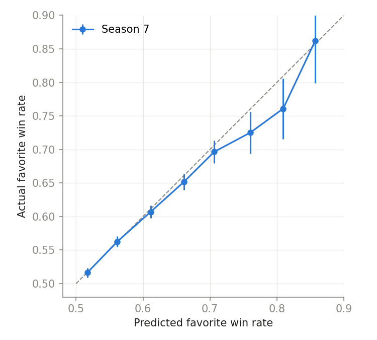
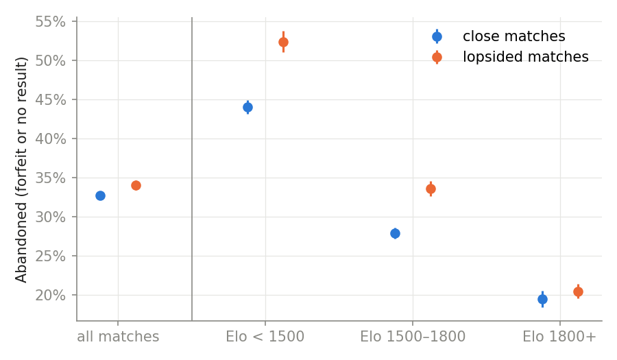
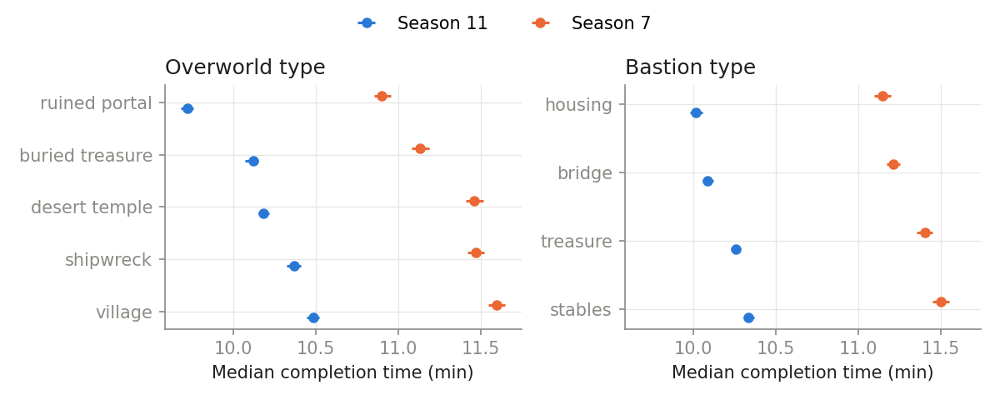

# Is MCSR Ranked's matchmaking working?

**Mostly, yes.** The rating system predicts who will win accurately, and the seed a match is played on doesn't change who wins. The weak spot is lopsided matches: players abandon them more often than close ones.

[MCSR Ranked](https://mcsrranked.com) is a 1v1 ladder for Minecraft speedrunning: two players race to beat the game on the same seed. This is an independent matchmaking and player-experience analysis of 80,161 ranked matches from Season 11 (Apr – Aug 2026) involving the top 150 players, with each finding checked against Season 7 (68,645 matches, Dec 2024 – Apr 2025).

## Findings

### 1. The rating system's win predictions are accurate



Like chess, MCSR Ranked uses Elo ratings. Before each match the system predicts each player's chance of winning from their rating gap, and sizes the rating change by it: beating the odds earns more points than winning as expected. The API doesn't publish these predictions, but the points reveal them. Each match moves 40 points (measured from the data, not documented; see [`sql/elo_calibration.sql`](sql/elo_calibration.sql)), so a favorite given a 70% chance gains 12 points for a win (40 × 30%) and loses 28 for a loss (40 × 70%).

Comparing those predictions with actual results, they differ by 0.6 percentage points on average (0.4 in Season 7). The misses are at the high end: favorites given a 70–75% chance win 67% of the time.

**Implication:** predictions are reliable enough to show players or to use in matchmaking as they are.

### 2. Lopsided matches are abandoned more often



A match is *close* if the favorite's predicted win probability is under 60% and *lopsided* otherwise, and *abandoned* if it ended in a forfeit or with no result. Skill level is the average of the two players' ratings. Overall, 27% of lopsided matches are abandoned vs. 19% of close ones, and the gap holds at every skill level: 21% vs. 37% at 1500–1800, 15% vs. 20% above 1800, and 36% vs. 84% below 1500 (only 500 lopsided matches).

Season 7 shows the same gap below 1800 (45% vs. 54% below 1500, 29% vs. 34% at 1500–1800), but not overall (35% vs. 36%): lower-rated matches were abandoned far more and were more often close, which hid it.

**Implication:** tighter matchmaking may reduce abandonment. This is observational, so it's a hypothesis for an experiment, not a result.

### 3. The seed pool is balanced



Seed assignment looks random: favorites are equally strong on every seed type, and average player rating differs by under 5 points (under 20 in Season 7). So differences between seed types are effects of the seed. Seed type shifts median completion time by under a minute (ruined portal 9.7, village 10.5) and completion rate by at most 4 points (76–80%). On every seed type, favorites win as often as predicted (within 1 point). Season 7 shows the same ordering and the same result.

**Implication:** no seed type needs removing.

## Data and limitations

- Every match involves at least one top-150 player, so results describe high-level play, not the whole ladder.
- Players are included because they finished the season in the top 150, so the sample is selected on success. Players who struggled or quit early are underrepresented, except as opponents.
- Only matches with a rated favorite are used for findings 1 and 2 (ties and unrated matches excluded).
- Completion times only count matches that finished, and finish rates differ slightly by seed type.
- Data from the [MCSR Ranked API](https://docs.mcsrranked.com).

## Reproduce

```sh
python3 fetch_data.py                 # download raw data to ~/mcsr-data (~1 hour per season; resumable)
pip install -r requirements.txt
python3 analysis.py                   # build tables, print results, save figures/
```

`sql/` holds the table build and each analysis; `test_build.py` checks the table build.

## Background

I built the original data pipeline in 2025, and Claude helped extend it.
